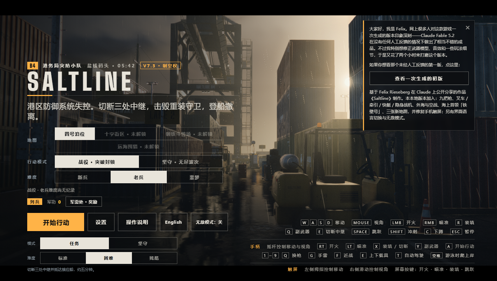
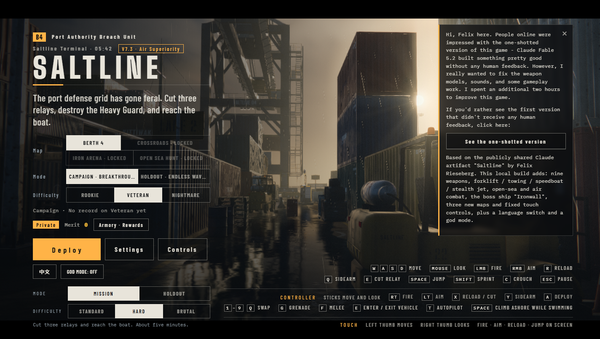
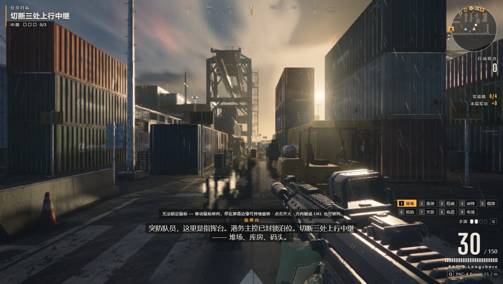

# Saltline · Extended

> 基于 Felix Rieseberg 在 Claude 上公开分享的作品《Saltline》做的本地化与功能扩展版，离线单文件、可直接部署到 GitHub Pages 在线运行。

> ⚠️ **未完整测试，可能存在未知 bug**；中文与英文界面文本均为**机器翻译，可能不准确**。
>
> **已知问题：** 暂无（原「ESC / 返回主菜单无法退出」已修复，见下方更新说明）。
>
> ⚠️ **Not fully tested — unknown bugs may exist**; both the Chinese and English UI texts are **machine-translated and may be inaccurate**.
>
> **Known issue:** None (the former "Back to menu" issue has been fixed, see the update note below).
>
> ✅ **2026-11 更新：** 修复了移动端虚拟摇杆无法移动的问题（真机 iOS 上引擎内部 `touch→move` 换算失效、向量恒为 0，改用 `stick-fix.js` 包装 `input.update` 直接写入摇杆向量绕开该链路）；修复了暂停后点击「返回主菜单」无效的问题 —— 现在会直接结束当前对局并回到主菜单（ESC 仍为暂停 / 继续）。详见 [README-mobile-fix.md](README-mobile-fix.md)。
>
> ✅ **Nov 2026 update:** Fixed the mobile virtual joystick not moving the player (on real iOS the engine's internal touch→move conversion silently produced a zero vector; `stick-fix.js` now wraps `input.update` and writes the joystick vector directly, bypassing that broken path); fixed "Back to menu" not working while paused — it now ends the current run and returns to the main menu (ESC still pauses / resumes). See [README-mobile-fix.md](README-mobile-fix.md).

[🇨🇳 中文](#zh) &nbsp;·&nbsp; [🇺🇸 English](#en)

---

<a id="zh"></a>
## 中文

### 这是什么

《Saltline》是一款用纯 HTML/Three.js 实现的 3D 第一人称港务突防小游戏。本仓库在原版基础上：

- **本地化**：主菜单增加语言切换按钮，默认中文，可一键切换英文；署名说明随语言切换。
- **无敌模式**：主菜单增加「无敌模式」开关，开启后受到攻击不触发死亡（保留受击反馈）。
- **功能扩展**（仅提取需要的增量，挂到原版引擎上）：九把枪、叉车 / 牵引 / 快艇 / 隐身战机、外海与空战、海上首领「铁壁号」、三张新地图、手机触屏修复。

原版是 **Felix Rieseberg**（[@felixrieseberg](https://x.com/felixrieseberg)）在 Claude 上发布的公开作品，本仓库以其为基底。功能扩展部分参考了 **X_mason13**（[@X_mason13](https://x.com/X_mason13)）的二开版本，但**未沿用其宣传改名**（如「Aggie速记英语 3A大作」），标题仍保持 `Saltline`。

### 在线试玩

GitHub Pages 已开启，直接访问：

- 游戏：<https://MKA930.github.io/saltline-extended/>
- 本说明（带语言切换按钮）：<https://MKA930.github.io/saltline-extended/readme.html>

### 截图

| 主菜单（中文） | 主菜单（英文） | 游戏内（中文） |
|---|---|---|
|  |  |  |

### 本地运行

双击 `index.html` 即可离线运行（无需服务器、无需联网）。

### 从源码重新构建

`index.html` 由 `build.py` 从上游基底叠加本地化与修复脚本生成；本仓库为精简交付，**直接提供已内联全部修复的成品 `index.html`**，并保留修复源码与构建脚本：

```bash
python build.py          # 输出 index.html（需在含上游基底的环境中运行）
node --check i18n.source.js   # 语法校验
```

- `build.py`：以原版英文基底为 BASE，从参考版抽取第 2 个 `<style>` 与第 2 个 `<script>`（V2~V9 扩展增量），叠加语言切换 / 无敌模式 / 署名说明，并做品牌清理与扩展兼容性垫片；随后在 `</head>` 前注入以下移动端修复：
  - `mobile-fix.css` / `mobile-fix.js`：禁默认手势 + 运行时 `preventDefault()` 兜底 + `?diag=1` 真机诊断浮层（左摇杆热区由 45% 放宽到 50%）；
  - `stick-fix.js`：包装 `input.update`，在引擎算完之后用摇杆向量覆盖 `input.move`，绕开 iOS 上失效的引擎内部 `touch→move` 链路；
  - `menu-fix.js`：暂停 / 阵亡 / 结算面板的「返回主菜单」改为走引擎状态机，直接结束对局回到主菜单。
- `i18n.source.js`：菜单 DOM 本地化层（中英双向字典 + 运行时 `MutationObserver` 监听），会被 `build.py` 内联进 `index.html`。

> 上游基底（原版英文 `Saltline/index.en.html`、参考二开版 `_ref/aggie.html`、本地化 `Saltline/i18n.source.js`）未随精简仓库分发，故 `build.py` 仅作文档化的注入配方；线上运行依赖已构建好的成品 `index.html`。

### 已知限制

原版把武器伤害 / 射速定义为只读 getter，「战场强化」中的伤害与射速升级无法写回原版引擎（弹匣容量、武器名可以）。这是原版引擎本身的限制，不影响九把枪切换、载具、空战与首领战。

### 许可

MIT License。Copyright (c) 2026 Winston (MKA930)。原作品版权归 Felix Rieseberg 所有；本仓库包含对其作品的修改与扩展。详见 [LICENSE](LICENSE)。

---

<a id="en"></a>
## English

### What this is

*Saltline* is a 3D first-person port-breaching game built as a single HTML file with Three.js. This repository extends the original:

- **Localization**: a language switch on the main menu (Chinese by default, one-click to English); the attribution note switches with it.
- **God mode**: a toggle on the main menu; when on, taking damage does not trigger death (hit feedback is preserved).
- **Feature extensions** (only the needed increment, layered onto the original engine): nine weapons, forklift / towing / speedboat / stealth jet, open-sea and air combat, the boss ship "Ironwall", three new maps, and fixed touch controls.

The base is the publicly shared Claude artifact **"Saltline"** by **Felix Rieseberg** ([@felixrieseberg](https://x.com/felixrieseberg)). The feature extensions reference the second-dev (fork) version by **X_mason13** ([@X_mason13](https://x.com/X_mason13)), but this repo does **not** adopt its rebranding (e.g. "Aggie速记英语 3A大作") — the title stays `Saltline`.

### Play online

GitHub Pages is enabled:

- Game: <https://MKA930.github.io/saltline-extended/>
- This README (with a language toggle button): <https://MKA930.github.io/saltline-extended/readme.html>

### Screenshots

| Menu (Chinese) | Menu (English) | In-game (Chinese) |
|---|---|---|
|  |  |  |

### Run locally

Double-click `index.html` — it runs fully offline (no server, no network).

### Rebuild from source

`index.html` is produced by `build.py` from the upstream base plus the localization and fix scripts. This repo ships a trimmed deliverable — it **ships the pre-built `index.html` with all fixes already inlined**, along with the fix sources and the build script:

```bash
python build.py          # emits index.html (run in an environment that has the upstream base)
node --check i18n.source.js   # syntax check
```

- `build.py`: uses the original English base, extracts the 2nd `<style>` and 2nd `<script>` (the V2–V9 extension increment) from the reference build, layers on language switch / god mode / attribution, and applies debranding plus an extension-compatibility shim; it then injects the following mobile fixes before `</head>`:
  - `mobile-fix.css` / `mobile-fix.js`: disabled default gestures + a runtime `preventDefault()` fallback + the `?diag=1` on-device diagnostic overlay (left joystick hot-zone widened from 45% to 50%);
  - `stick-fix.js`: wraps `input.update` and overwrites `input.move` with the joystick vector after the engine finishes, bypassing the broken internal `touch→move` path on iOS;
  - `menu-fix.js`: the "Back to menu" button on the pause / death / results panels is rerouted through the engine state machine, ending the run and returning to the main menu.
- `i18n.source.js`: the menu DOM localization layer (bidirectional CN/EN dictionary + runtime `MutationObserver`); `build.py` inlines it into `index.html`.

> The upstream base (original English `Saltline/index.en.html`, reference second-dev `_ref/aggie.html`, localization `Saltline/i18n.source.js`) is not shipped in this trimmed repo, so `build.py` serves mainly as a documented injection recipe; the live build depends on the pre-built `index.html`.

### Known limitations

The original defines weapon damage / fire-rate as read-only getters, so the "field upgrades" for damage and fire-rate cannot be written back to the original engine (magazine size and weapon name can). This is a limitation of the original engine and does not affect weapon switching, vehicles, air combat, or the boss fight.

### License

MIT License. Copyright (c) 2026 Winston (MKA930). The original work is © Felix Rieseberg; this repository contains modifications and extensions of it. See [LICENSE](LICENSE).
